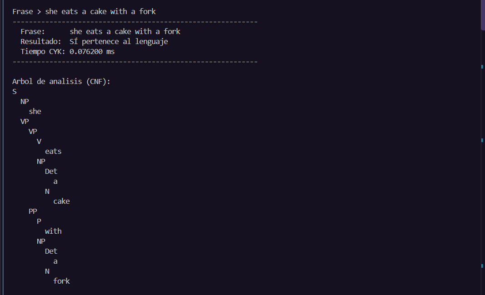
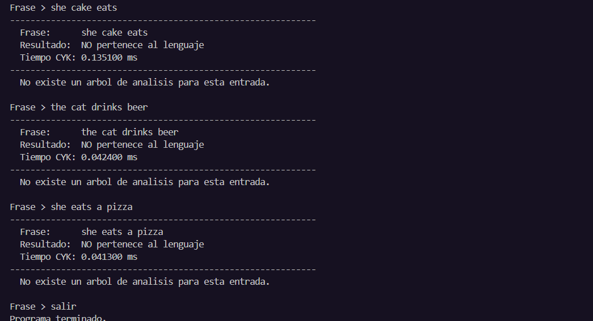
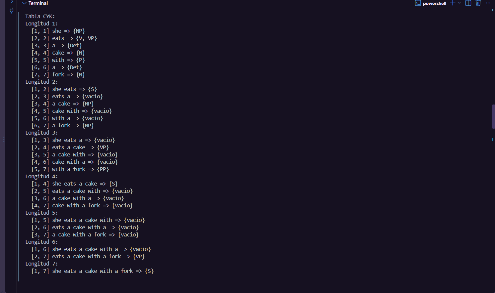
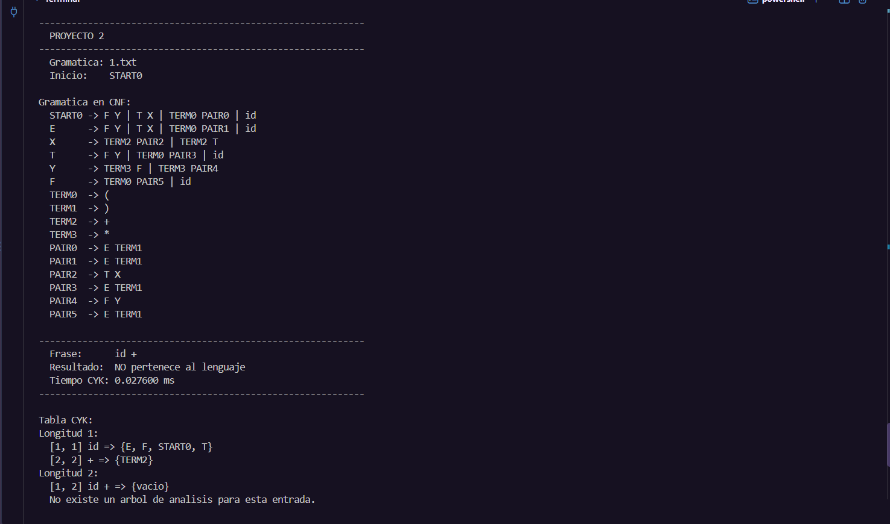
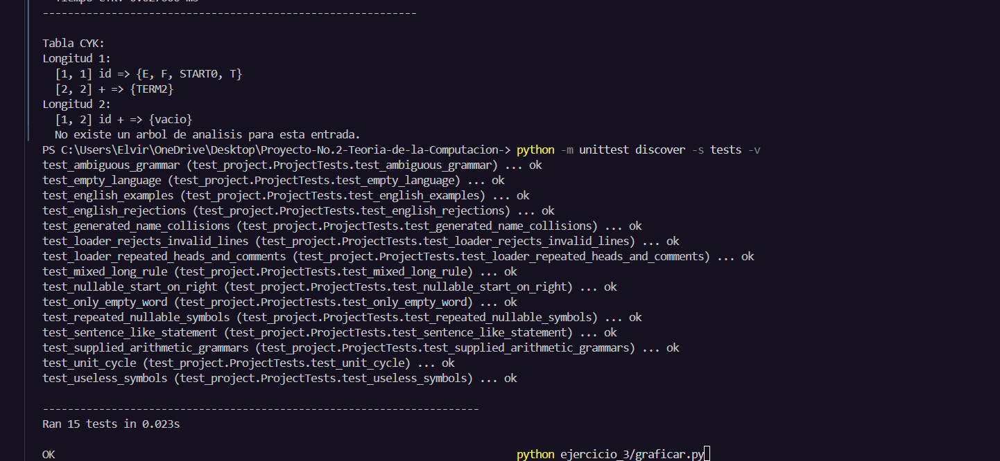

# Proyecto 2

## Cómo ejecutarlo

Abre una terminal en la carpeta del proyecto y ejecuta:

```powershell
python main.py
```

El programa carga la gramática de inglés, muestra su CNF y las instrucciones.
Después pide frases una por una hasta escribir `salir`:

```text
Frase > she eats a cake with a fork
------------------------------------------------------------
  Frase:      she eats a cake with a fork
  Resultado:  SÍ pertenece al lenguaje
  Tiempo CYK: <valor medido> ms
------------------------------------------------------------
```

También puedes enviar la frase directamente:

```powershell
python main.py --sentence "she eats a cake with a fork"
python main.py --sentence "the cat drinks the beer" --table
python main.py --grammar grammars/1.txt --sentence "( id * id ) + id" --steps --table
python main.py --grammar grammars/1-cnf.txt --sentence "id + id"
```

Se puede escribir la frase como en el enunciado (`She eats a cake with a fork`
o `The cat drinks the beer.`): si una palabra no es terminal de la gramática, se
pasa a minúsculas y se le quita el punto final. Los operadores y paréntesis
también se separan con espacios; `id` cuenta como un solo terminal.

| Opción | Para qué sirve |
| --- | --- |
| `--grammar archivo.txt` | Lee otra gramática; por defecto usa `grammars/english.txt`. |
| `--sentence "entrada"` | Revisa una sola frase sin el modo interactivo. |
| `--steps` | Muestra cada etapa de la conversión a CNF. |
| `--table` | Muestra las variables reconocidas para cada intervalo. |

Las rutas relativas de `--grammar` parten de la carpeta actual de la terminal.
La ruta de la gramática predeterminada se calcula desde `main.py`.

## Formato de las gramáticas

```text
S -> A B
A -> a | e
B -> b
```

- La primera variable del archivo es el símbolo inicial.
- Cada regla usa `->` y cada alternativa usa `|`.
- Los símbolos del lado derecho se separan con espacios.
- Una variable es cualquier símbolo que aparece a la izquierda de alguna regla.
- Los demás símbolos son terminales, aunque tengan varias letras, como `id`.
- `e`, `epsilon` y `ε` representan la cadena vacía y son palabras reservadas.
- Se permiten líneas vacías, comentarios que comienzan con `#` y variables repetidas.
- No se permiten alternativas vacías como `A -> a |`; escribe `A -> a | e`.
- `#` inicia un comentario solo al principio de una línea; no hay comentarios al final de reglas.

Para probar la cadena vacía, presiona Enter cuando se pide la frase. Si la
gramática no la genera, el resultado será NO.

## Diseño de la aplicación

El flujo sigue este orden:


| Archivo | Responsabilidad |
| --- | --- |
| `main.py` | Recibe opciones, coordina el proceso y muestra resultados. |
| `grammar.py` | Lee, simplifica, convierte y comprueba la gramática. |
| `cyk.py` | Construye la tabla dinámica y reconstruye el árbol. |
| `grammars/english.txt` | Gramática de inglés de las instrucciones. |
| `grammars/1.txt` | Gramática aritmética original del ejemplo. |
| `grammars/1-cnf.txt` | Gramática aritmética en CNF proporcionada como referencia. |
| `tests/test_project.py` | Pruebas automáticas de conversión y reconocimiento. |

La única clase está en las pruebas, porque es el formato habitual de `unittest`.

Una gramática se representa así:

```python
grammar = {
    "S": {("A", "B")},
    "A": {("a",), ()},
    "B": {("b",)},
}
```

La clave es la variable, cada tupla es una producción y `()` representa epsilon.
Los conjuntos evitan reglas repetidas. Las etapas de conversión crean nuevas
estructuras para conservar las anteriores y poder mostrarlas con `--steps`.

## Simplificación y conversión a CNF

CNF admite reglas `A -> B C` o `A -> a`. Aquí también se admite `S -> e` si el
lenguaje incluye la cadena vacía, con un inicio que no aparece en cuerpos.

1. **Proteger el inicio.** Si aparece a la derecha, se crea un inicio nuevo.
2. **Eliminar reglas vacías.** Se buscan variables anulables hasta que no aparezcan más.
   Se agregan las combinaciones que omiten sus apariciones, conservando epsilon
   únicamente en el inicio si corresponde.
3. **Eliminar reglas unitarias.** Para cada variable se siguen reglas `A -> B` y se
   copian las producciones no unitarias alcanzadas. Un conjunto evita ciclos.
4. **Eliminar símbolos inútiles.** Se descartan reglas que no pueden terminar en
   terminales y luego variables que no pueden alcanzarse desde el inicio.
5. **Separar terminales.** En cuerpos largos se crean auxiliares como `TERM0 -> +`.
6. **Dividir cuerpos largos.** Por ejemplo, `A -> B C D` pasa a `A -> B PAIR0`
   y `PAIR0 -> C D`.

Los nombres auxiliares se revisan para no coincidir con símbolos existentes.
Una CNF equivalente puede usar otros nombres y tener más o menos auxiliares que
el ejemplo del curso. Lo que debe conservarse es el lenguaje.

La gramática de inglés ya cumple CNF; la aritmética permite observar la
eliminación de epsilon y reglas unitarias, además de la separación de terminales
y la división de cuerpos largos. La recursión izquierda no necesita eliminarse
para aplicar CYK; este programa acepta reglas recursivas.

## CYK y programación dinámica

La programación dinámica guarda resultados pequeños para reutilizarlos en
problemas más grandes. CYK comienza reconociendo cada terminal, después pares
de terminales y luego fragmentos cada vez más largos.

En `table[left][right]` se guardan las variables que generan los símbolos entre
esas posiciones, inclusive. Para llenar una celda se prueban todas las posiciones
de corte. Si una parte produce `B`, la otra produce `C` y existe `A -> B C`, se
agrega `A` a esa celda. 

Ejemplo para `she eats`:

```text
[1, 1] she      => {NP}
[2, 2] eats     => {V, VP}
[1, 2] she eats => {S}
```

Como existe `S -> NP VP`, el inicio aparece en el intervalo completo y la frase
se acepta. En el código las posiciones comienzan en cero; al mostrarlas comienzan
en uno para que resulte más fácil leerlas.

La base es `table[i][i] = {A : A -> token[i]}`. Para `i < j`, se agrega `A` si
existe algún corte `k` tal que `A -> B C`, con `B` en `table[i][k]` y `C` en
`table[k + 1][j]`. La entrada se acepta si el inicio está en `table[0][n - 1]`.
La cadena vacía se resuelve por separado comprobando la regla de epsilon inicial.

Se crean dos índices: uno para terminales y otro para pares de variables. Así,
cada combinación consulta únicamente las reglas correspondientes. Para una
gramática fija, el tiempo crece como `O(n³)` y el espacio como `O(n²)`, con `n`
igual al número de símbolos de entrada. La conversión tiene un costo aparte que es
omitir muchas apariciones anulables puede generar numerosas combinaciones.

## Árbol de análisis y tiempo

Cada variable de una celda guarda su terminal o una referencia de la forma
`(split, first, second)`. Esas referencias permiten reconstruir un árbol sin
repetir la búsqueda. Si hay ambigüedad, se conserva el primer árbol encontrado.
El árbol corresponde a la CNF y puede contener variables auxiliares.

Ejemplo de salida para `she eats`:

```text
Resultado: SÍ
Tiempo CYK: <valor medido> ms

Arbol de analisis (CNF)
S
  NP
    she
  VP
    eats
```

El tiempo se obtiene con `perf_counter` y se presenta en milisegundos. Incluye
crear los índices, llenar la tabla y reconstruir el árbol.

## Ejemplos y pruebas realizadas

| Entrada | Resultado esperado | Motivo |
| --- | --- | --- |
| `she eats a cake with a fork` | SÍ | Verbo con objeto y frase preposicional. |
| `the cat drinks the beer` | SÍ | Sujeto y objeto con determinante. |
| `he cooks` | SÍ | La gramática permite un verbo sin objeto. |
| `she eats the soup in the oven` | SÍ | Frase preposicional después del objeto. |
| `the knife drinks a cat` | SÍ | La sintaxis es válida aunque el significado resulte extraño. |
| `she cake eats` | NO | Orden incompatible con las reglas. |
| `the cat drinks beer` | NO | Ese sustantivo necesita determinante. |
| `she eats a pizza` | NO | `pizza` no está en la gramática. |
| `she` | NO | Falta el predicado. |
| cadena vacía con la gramática inglesa | NO | No existe una derivación vacía. |
| `( id * id ) + id` con `1.txt` | SÍ | Expresión aritmética válida. |
| `id +` con `1.txt` | NO | Falta el operando derecho. |

Para ejecutar las pruebas:

```powershell
python -m unittest discover -s tests -v
```

### Evidencia de las pruebas manuales

En la ejecución interactiva probamos `he cooks`, `she eats a cake with a fork` y
`the cat drinks the beer`. Las tres fueron aceptadas. En el árbol de la segunda
frase se puede seguir la combinación del sujeto, el verbo, el objeto y la frase
preposicional `with a fork`.



Después probamos tres errores distintos: `she cake eats` cambia el orden de las
palabras, `the cat drinks beer` omite el determinante del objeto y `she eats a pizza`
contiene una palabra ajena a la gramática. Las tres entradas fueron rechazadas y
el programa indicó que no existía un árbol de análisis.



Para revisar la tabla ejecutamos:

```powershell
python main.py --sentence "she eats a cake with a fork" --table
```

`a cake` y `a fork` se reconocen como `NP`, y `with a fork` como `PP`.
El intervalo final `[1, 7]` contiene `S`, por lo que la frase completa se acepta.
Las celdas vacías corresponden a fragmentos que ninguna variable puede generar.



También probamos una expresión aritmética incompleta:

```powershell
python main.py --grammar grammars/1.txt --sentence "id +" --table
```

Aunque ambos símbolos se reconocen por separado, la celda del intervalo completo
queda vacía. Falta el operando después de `+` y la expresión se rechaza.



Los tiempos corresponden a ejecuciones individuales. Por ejemplo, la frase
`she eats a cake with a fork` tomó 0.076200 ms en el modo interactivo y
0.059500 ms en la ejecución con tabla. No son promedios ni valores que deban
repetirse al ejecutar el programa otra vez.

### Pruebas automáticas

La ejecución terminó con `Ran 15 tests` y `OK`, como muestra la captura:



Se realizaron 15 pruebas automáticas y todas fueron exitosas. Estas pruebas nos ayudaron a comprobar que el programa funciona correctamente en diferentes situaciones, desde frases sencillas en inglés hasta gramáticas más complicadas. También se probaron casos especiales, como reglas repetidas, símbolos que no se utilizan, gramáticas ambiguas y archivos con errores.

Además, se hicieron comparaciones entre la gramática original y su versión en Forma Normal de Chomsky (CNF) para verificar que ambas aceptaran las mismas palabras. También se revisó que el algoritmo CYK diera los resultados esperados. En el caso de las expresiones aritméticas, se probaron combinaciones de hasta cinco símbolos. Aunque estas pruebas no garantizan que todas las frases posibles funcionen, sí nos permiten tener mayor confianza en los resultados del programa.

## Discusión y recomendaciones

Durante el desarrollo encontramos algunos casos que necesitaban mucha atención. Uno de ellos fue diferenciar correctamente las variables de los símbolos terminales, ya que eliminar una variable antes de tiempo podía afectar el funcionamiento de la gramática. Otro aspecto importante fue manejar las reglas que contienen símbolos que pueden desaparecer. En estos casos, tuvimos que asegurarnos de considerar todas las combinaciones posibles sin repetir resultados innecesariamente para que el programa fuera más fácil de utilizar y entender, decidimos mostrar el árbol sintáctico con sangrías y organizar la tabla de resultados por intervalos. De esta manera, podemos observar cómo se analiza cada frase sin necesidad de utilizar herramientas gráficas adicionales. Por ahora, el programa muestra un solo árbol por frase aceptada, aunque algunas gramáticas pueden tener más de una interpretación.

## Presentación del Proyecto

[Video Explicativo ]((https://canva.link/mztfvlgyxm2xufs))


